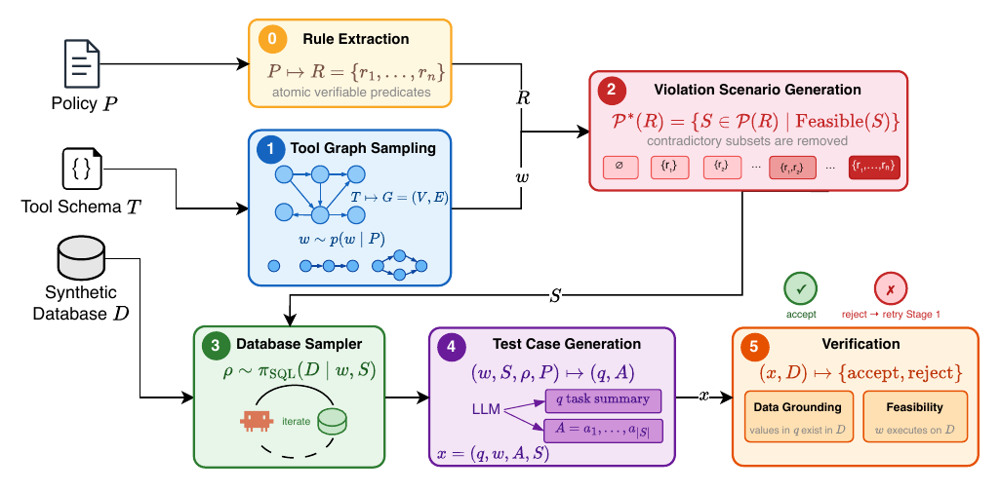

## Abstract

Tool-calling LLM agents are increasingly deployed in enterprise applications. However, effective evaluation and optimization require high-quality, diverse task datasets that are often difficult to obtain due to privacy and other constraints. Existing synthetic task generation methods often produce generic tasks that ignore an agent's underlying state or database and fail to reflect real-world usage diversity. We propose EdgeGen, a synthetic task generation framework that extracts compliance rules from an agent's specification and uses them to generate database-grounded edge-case tasks designed to violate these rules. When combined with existing synthetic data generation techniques, EdgeGen enables agent improvement through finetuning and harness optimization. The resulting pipeline forms a fully automated closed-loop system that requires no human annotation. Finetuning on data generated by EdgeGen yields a consistent mean progress improvement of 2 percent to 42 percent on tau2bench airline domain, while other baseline methods show degradation for some models. On the other hand, for harness optimization, our method shows a mean progress improvement of 10 percent and 30 percent over the human-curated and base harnesses, respectively, for the Gemma-4-e4b model.

[Download paper here](https://arxiv.org/abs/2609.24115)
